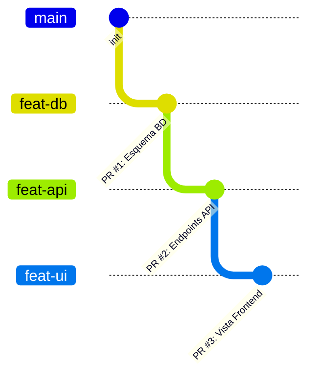

# gh stack

## Paso A: Iniciar la pila y crear el primer PR

Estando en la rama principal (main), inicializas la pila creando la primera capa (la base de la funcionalidad):

```bash
# 1. Crear la primera rama de la pila a partir de main
# Esto me cambia automáticamente a la rama nueva
gh stack init feat-db

# 2. Hacer cambios, preparar archivos y crear el primer commit
git add .
git commit -m "feat: add user table"

# 3. Subir la rama y crear el PR #1 apuntando a main
gh stack submit
```

Nota: `gh stack submit` abre un editor interactivo en la CLI para confirmar títulos y si los PR se publican listos para revisar o como borrador.

Nota: Si ya habías empezado a escribir código estando en `main` sin crear rama, `gh stack init feat-db` también crea la rama y se lleva tus cambios sin guardar hacia `feat-db` sin perder nada, aunque lo más ordenado es crear la rama primero.

## Paso B: Apilar varios PR seguidos 

Sin esperar que aprueben el PR #1, sigues trabajando agregando capas superiores con gh stack add . Puedes guardar los cambios al mismo tiempo con -Am:

```bash
# 4. Estando en feat-db, crear la segunda capa (PR #2)
gh stack add feat-api

# Escribes el código y lo añades 
git add .
git commit -m "feat: endponts"

# 5. Crear la tercera capa (PR #3) encima de feat-api en un solo paso
gh stack add feat-ui -Am "feat: form"

# 6. Revisar el estado local de toda la pila antes de subir
gh stack submit 
```

## Paso C: Modificar un PR intermedio y propagar cambios 

Supongamos que un revisor te pida cambios en el PR #1 (feat-db) o en el PR #2 (feat-api). Como las ramas superiores dependen de ellas, debes bajar, corregir y hacer un `rebase` en cascada.

Nota de Git: Antes de cambiar de rama, tu rama actual (feat-ui) debe estar limpia (sin cambios sin guardar) si tienes algo a medias, haces un commit temporal o `git stash`.

```bash
# 8. Bajar hacia la rama que necesitas corregir (o usar: gh stack checkout feat-db)
gh stack down # baja a feat-api
gh stack down # baja a feat-db

# 9. Aplicar la corrección y hacer commit (o amend)
git add .
git commit -m "fix: Correct index"

# 10. Propagar el cambio hacia arriba (rebase en cascada sobre feat-api y feat-ui)
gh stack rebase

# 11. Subir todas las ramas actualizadas a GitHub
gh stack push
```

Opcionalmente, gh stack sync combina traer cambios remotos, hacer el rebase en cascada y subir las ramas en un solo comando.

## Ramas de trabajo



## ¿Qué pasa si ya tienes ramas creadas previamente con `git branch`?

Si alguna vez empezaste a trabajar de forma tradicional creando ramas con `git checkout -b` antes de usar `gh stack`, no tienes que borrarlas: te sitúas en cada rama existente y usas `gh stack track` en lugar de `init` o `add` para indicarle a `gh stack` cual es la rama padre de cada una.

## Comandos rápidos de navegación y mantenimiento

- Moverse por la pila: `gh stack up` sube hacia el PR final, `gh stack down` baja hacia main, `gh stack top` y `gh stack bottom`.
- Reorganizar o fusionar capas: `gh stack modify`abre una interfaz interactiva para reordenar ramas, eliminar capas o fusionar dos ramas en una.
- Fusionar en `main`:  `gh stack merge` fusiona en orden toda la pila (o hasta el PR que indiques) y limpia las ramas correspondientes.